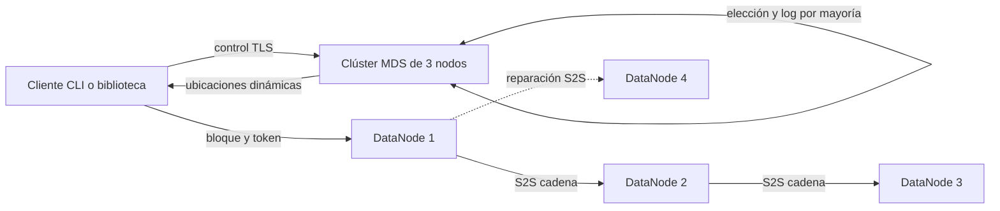

# DFSha Fase II

DFSha es un prototipo ejecutable de sistema de archivos distribuido para la Opción 1 cliente servidor con comunicación servidor a servidor. Separa el plano de control en tres Metadata Servers y el plano de datos en cuatro DataNodes. La escritura envía cada bloque una sola vez al primer DataNode y continúa por una cadena S2S; la reparación copia bloques directamente desde una réplica sana.

El repositorio cubre RF1 a RF3, partición, réplica R igual a 3, confirmación mínima W igual a 2, elección de líder, metadatos por mayoría, leases exclusivos con fencing, hashes SHA 256, cifrado AES 256 GCM, TLS, autorización por usuario, pruebas de fallos y mediciones reproducibles.

## Estado verificado

El 6 de noviembre de 2026 pasaron 9 pruebas en Windows en 40.87 segundos, con servicios reales separados, TLS, corrupción de una réplica, transferencia interrumpida y escritores simultáneos. La evidencia está en `evidence/pytest-expanded.xml`. También se validaron Python y Docker Compose con TLS en GitHub Actions.

Las pruebas verificaron:

- RF1 con `ls`, `mkdir`, `rmdir`, `rm`, `stat` y `cd` local en el cliente.
- RF2 con carga, partición, réplica, descarga y SHA 256 final.
- RF3 con `open`, `read`, `write`, `append`, `close` y `lock` exclusivo.
- Rechazo del segundo escritor con `LOCKED`.
- Rechazo de un usuario que intenta acceder al árbol de otro usuario.
- Lectura después de detener un DataNode y reparación automática hacia otro nodo.
- Elección de un MDS nuevo después de detener al líder y un commit posterior al relevo.
- Cifrado en reposo comprobando que el archivo `.blk` no contiene el texto plano.

Se ejecutó Docker en tres máquinas t3.micro de AWS Academy, en us-east-1a, us-east-1b y us-east-1c. Se recuperó un archivo de 16 MiB más 20 bytes, dividido en 17 bloques, con SHA-256 idéntico. Pasaron las pruebas de RF1-RF3, TLS, autorización, escritura con una réplica desconectada, reparación, relevo de líder y rechazo sin mayoría. Las evidencias están en `evidence/aws/`. Los servicios no tienen puertos de entrada abiertos a Internet. Las máquinas se detienen al terminar la validación; sus discos conservan la demostración.

## Arquitectura



Los MDS almacenan namespace, versiones, manifiestos y leases. Los DataNodes almacenan bloques cifrados e inmutables. Un archivo solo se publica cuando todos sus bloques tienen por lo menos dos réplicas completas y el commit entra en el log del clúster MDS.

## Inicio rápido local

Requiere Python 3.11 o posterior.

```powershell
python -m venv .venv
.\.venv\Scripts\python.exe -m pip install -r requirements-dev.txt
.\.venv\Scripts\python.exe -m pytest -q -s
```

La prueba de integración inicia y detiene tres MDS y cuatro DataNodes automáticamente, con puertos libres y directorios temporales.

## Inicio con Docker

1. Ejecutar `python scripts/init_environment.py` para generar `.env` con secretos y claves aleatorios. El programa no reemplaza archivos existentes.
2. Generar la CA y los certificados de desarrollo.
3. Levantar los siete servicios.

```powershell
python scripts\generate_certs.py
docker compose up --build -d
docker compose ps
```

El cliente se ejecuta dentro de la red privada de Compose para que pueda seguir las direcciones internas anunciadas por el líder:

```powershell
docker compose --profile tools run --rm client dfsha ls /
docker compose --profile tools run --rm client dfsha mkdir /docs
docker compose --profile tools run --rm -v ${PWD}:/host client dfsha put /host/archivo.bin /docs/archivo.bin
docker compose --profile tools run --rm -v ${PWD}:/host client dfsha get /docs/archivo.bin /host/copia.bin
```

Para apagar sin borrar volúmenes:

```powershell
docker compose down
```

Para reiniciar desde cero y borrar los datos de la demostración:

```powershell
docker compose down -v
```

## CLI

La configuración puede darse por argumentos o variables de entorno:

```powershell
$env:DFSHA_MDS_URLS='http://127.0.0.1:8001,http://127.0.0.1:8002,http://127.0.0.1:8003'
$env:DFSHA_USER='demo'
$env:DFSHA_PASSWORD='demo-change-me'
dfsha ls /
dfsha put .\entrada.bin /entrada.bin
dfsha read /entrada.bin 0 128
dfsha write /entrada.bin 64 'nuevo texto'
dfsha append /entrada.bin 'final'
dfsha lock /entrada.bin --hold 10
```

## Semántica de RF3

- `open read` fija un snapshot de versión hasta `close`.
- `open write` toma un lease exclusivo del archivo por 30 segundos.
- `write` admite creación, reemplazo, anexado y modificación parcial por copy on write.
- No se permiten huecos más allá de EOF.
- Los demás lectores ven la versión nueva solamente después del commit.
- El epoch del lease funciona como fencing token y bloquea escritores vencidos.
- La atomicidad visible es por archivo y por commit, no POSIX completa.

## Documentación

- `docs/COMPARACION.md` compara los dos diseños individuales.
- `docs/ARQUITECTURA.md` explica componentes, algoritmos y flujos.
- `docs/API.md` describe los contratos HTTP.
- `docs/PRUEBAS.md` define la matriz reproducible y registra resultados reales.
- `docs/DESPLIEGUE.md` cubre Docker y AWS Academy.
- `docs/SEGURIDAD.md` documenta el modelo de amenazas y controles.
- `docs/LIMITACIONES.md` separa las garantías demostradas de las extensiones futuras.
- `docs/CONTRIBUCIONES.md` indica cómo dejar contribuciones trazables de ambos estudiantes.
- `docs/INFORME_TECNICO.md` es la fuente del informe final.
- `docs/GUION_VIDEO.md` distribuye una demostración de 12 minutos.

## Alcance del consenso

La implementación contiene el núcleo verificable de Raft: términos persistentes, votos, elección, `AppendEntries`, comprobación de log, mayoría, índice de commit y aplicación ordenada. No implementa snapshots, cambio dinámico de membresía, pre vote ni optimizaciones de producción. El informe la denomina implementación Raft mínima del prototipo y no un clúster de producción.

No se afirma linealizabilidad de lecturas ante un líder aislado: falta una barrera ReadIndex. La reparación detecta ausencia por sondeo; una corrupción se detecta al leer y permite probar otra réplica, pero no hay scrubbing automático del disco. El epoch se combina con un holder UUID y versión base; no se ofrece un contador persistente entre todos los leases ya liberados.

## Reproducir el despliegue AWS

`docs/DESPLIEGUE.md` describe el controlador `scripts/aws_lab.py`, la topología real, las fases de prueba y la detención. Las credenciales temporales y el estado con secretos quedan fuera de GitHub. `docs/ENTREGA.md` enumera los entregables y las tareas personales que siguen correspondiendo a los integrantes.

## Licencia académica

Este código se entrega como trabajo académico de Sistemas Distribuidos 2026 2. Los estudiantes deben revisar, ejecutar y poder explicar cada decisión antes de presentarlo.

